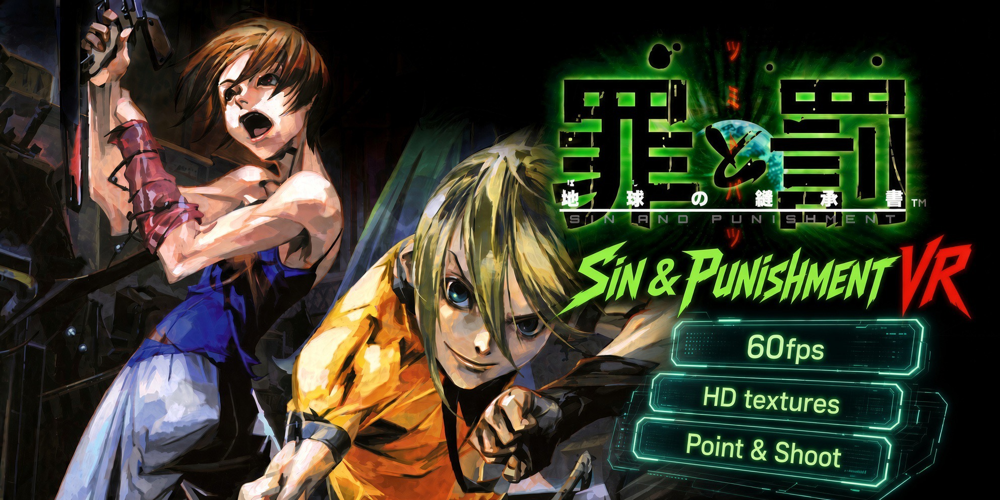
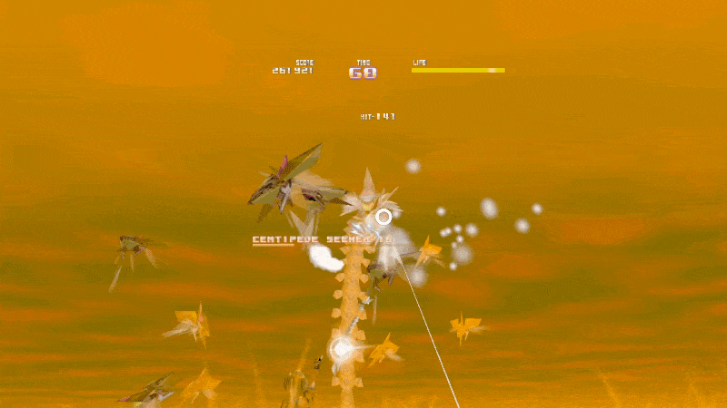

<p align="center">
  
</p>

<p align="center">
  
</p>

# Sin & Punishment VR

Treasure's N64 rail shooter **Sin and Punishment** (*Tsumi to Batsu: Hoshi no Keishousha*), running natively on the **Meta Quest 3**. No PC, no streaming: it is a standalone app. Point your controller at the enemies, pull the trigger, and look around the stage with your head.

> Unofficial fan project, not affiliated with the rights holders. **No game data is included.** You need your own ROM of the game.

## Features

- **Point & Shoot.** Aim by pointing your right Touch controller. The reticle follows where you point, the trigger fires, and the controller buzzes when you shoot.
- **The headset is the camera.** In the stages you can look around freely. The game is drawn about 120 x 104 degrees wide, much wider than the original picture, and the horizon stays level while you aim.
- **60 fps.** Smooth, high frame rate motion instead of the original 30.
- **HD textures.** Loads Rice-format (emulator `hires_texture`) texture packs, so the game can look sharper than it ever did on the N64.
- **Big virtual screen for menus.** The title, menus and cutscenes show on a large floating screen in front of you. Stages switch to the full surround view.
- **Small, sharp HUD.** Score, life and timer are shrunk toward the middle of your view and drawn crisply, so you can read them without turning your head.
- **Built-in ROM window.** Every start shows a window with the key art where you choose your ROM, or play with the one you picked before. Japanese ROMs and the English fan translation both work.
- **Native Quest 3 app.** Built on OpenXR, running the game as recompiled code (not an emulator).

## Controls

| Action | Control |
|---|---|
| Aim | Point the right controller |
| Fire | Right trigger |
| Jump | Right **A** (or either grip) |
| Move | Left thumbstick |
| Pick a lock-on target | Right thumbstick |
| Select in menus | Right trigger on the menu, or **A** / **X** |
| Start / pause | Left menu button |
| Recenter the view | Click the right thumbstick |

## Install

You need a Quest 3 with [developer mode](https://developers.meta.com/horizon/documentation/native/android/mobile-device-setup/) turned on.

1. Download **Sin-and-Punishment-VR-0.1.0.apk** from the [Releases](../../releases) page.
2. Install it on the headset with SideQuest, Meta Quest Developer Hub, or adb:

   ```bash
   adb install -r Sin-and-Punishment-VR-0.1.0.apk
   ```
3. Put your ROM (`.z64`, `.n64` or `.v64`) on the headset, for example in its Downloads folder.
4. Start **Sin and Punishment VR** from *Unknown Sources* in your library.
5. In the ROM window choose **Choose ROM file** and pick your ROM. It is copied into the app once. After that the window shows **Play**, so you can start right away.

## HD textures

Copy a Rice-format texture pack folder into:

```
Android/data/com.sinandpunishment.recompiled/files/snprecomp/texture_packs/
```

(with adb push, or any file manager that can reach that folder) and start the game. Packs made for N64 emulators' `hires_texture` folder work.

## What's new in 0.1.0

First release.

- Quest 3 version of the game with point-and-shoot aiming.
- The headset is the camera in stages (wide 120 x 104 degree view, level horizon).
- Menus and cutscenes on a floating screen.
- 60 fps.
- HD texture pack support.
- Jump on the right A button.
- Small, crisp HUD.
- ROM window with the key art.

## Known issues

- Beta. If something looks wrong or crashes, please open an issue and say which stage you were in.
- The in-game text is small on purpose (the HUD is pulled in so it fits your view); it is a bit soft because the original letters are tiny.
- Quest 3 only. Other headsets are untested.

## Credits

This project builds on the work of many people:

- [wootbeer/snprecomp](https://github.com/wootbeer/snprecomp), the PC recompilation of Sin and Punishment this port is based on.
- [N64: Recompiled](https://github.com/N64Recomp/N64Recomp), [N64ModernRuntime](https://github.com/N64Recomp/N64ModernRuntime) and [RecompFrontend](https://github.com/N64Recomp/RecompFrontend).
- [RT64](https://github.com/rt64/rt64), the renderer.
- Sin and Punishment is a trademark of Nintendo and Treasure. This is an unofficial fan project.
